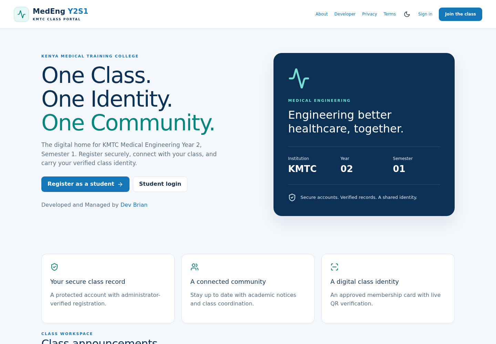
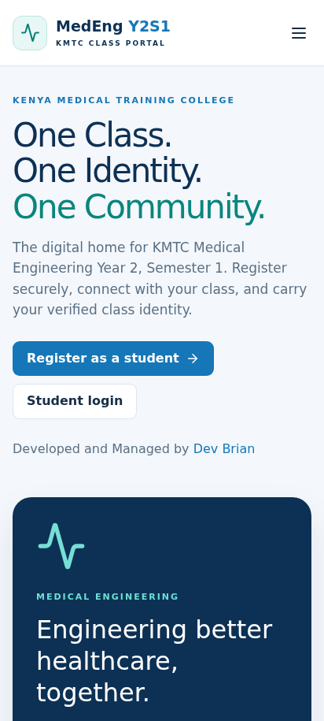
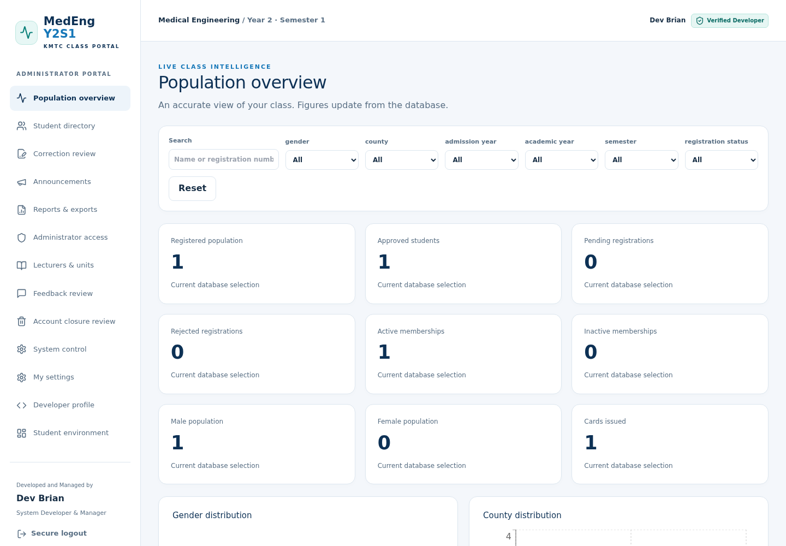
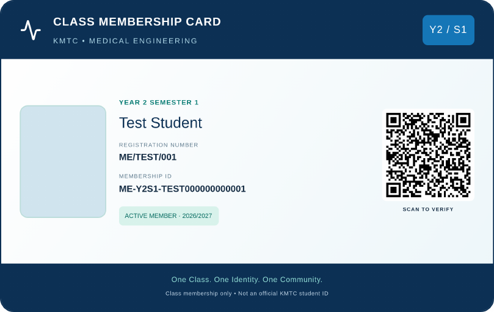
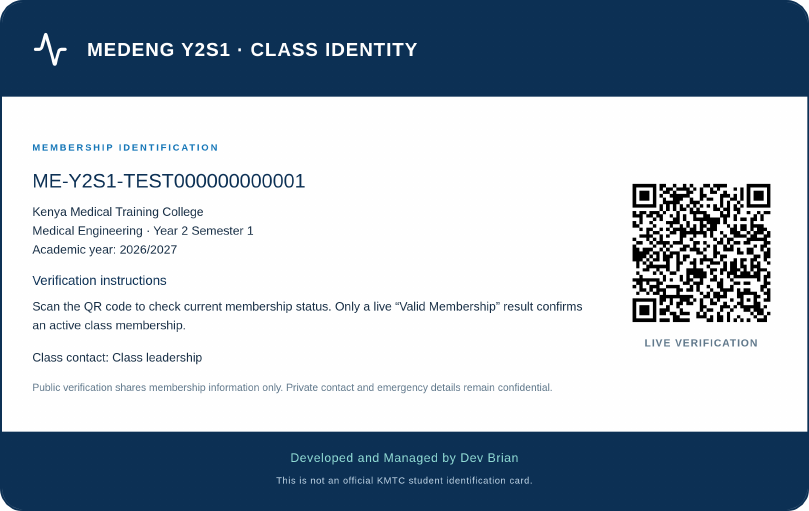
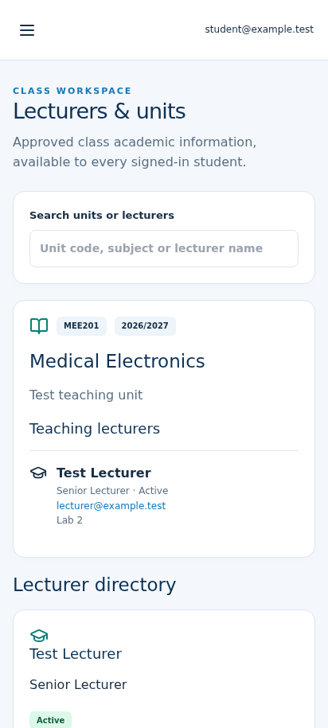
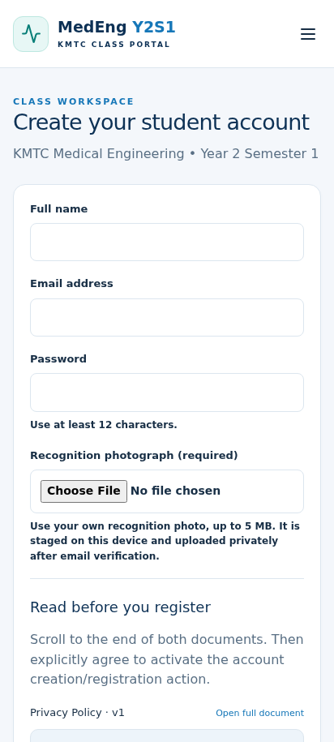
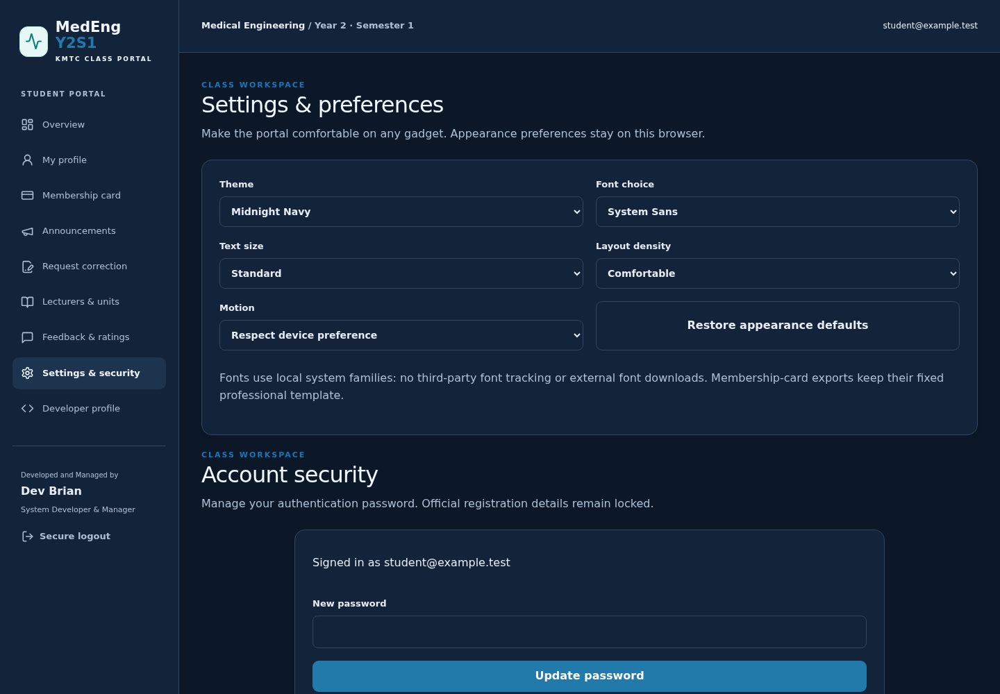
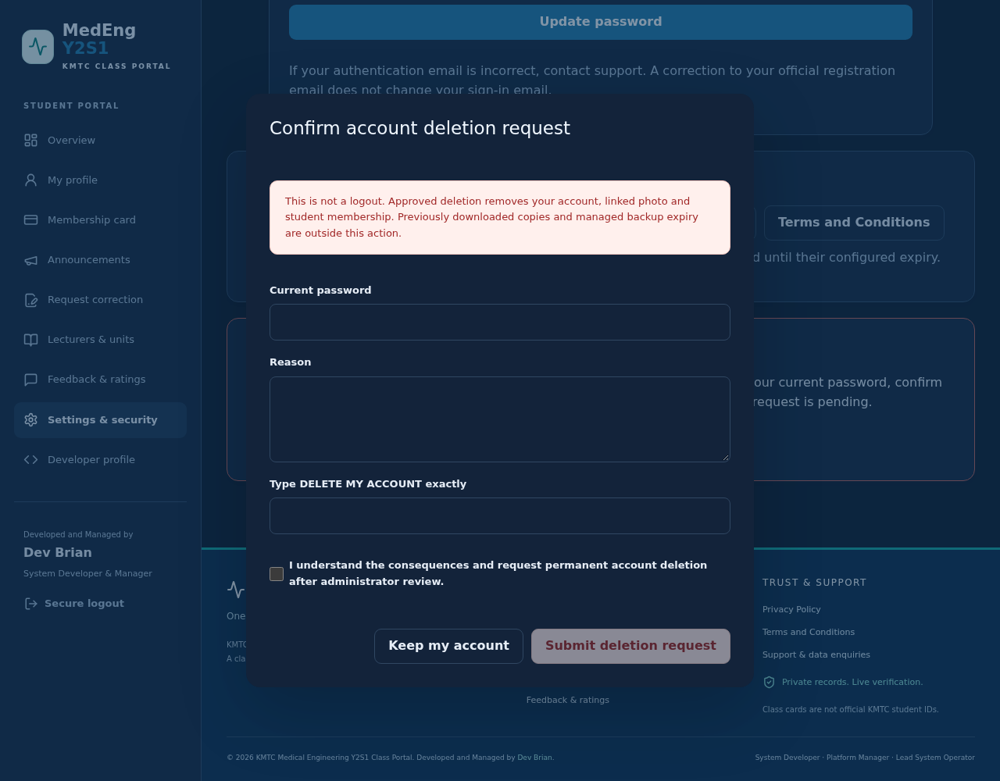
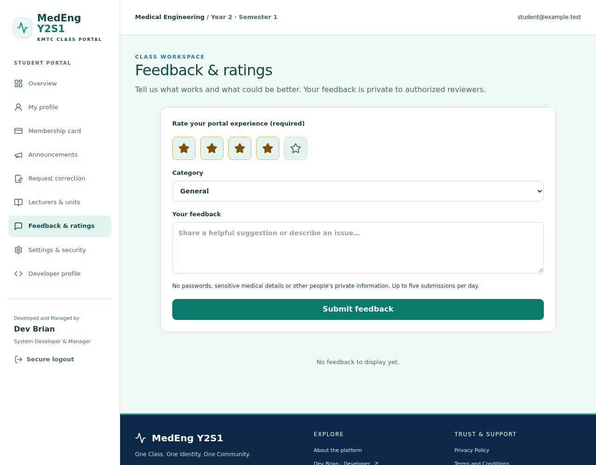

# Interface previews

These are locally inspected interface states. Private dashboard and card images use clearly identified **test-only records**, not real students or live population data.

## Desktop landing

## Mobile landing

## Administrator dashboard — test data only

## Card exports — test student, not an official KMTC ID

## Student academic directory — test data only

## Required photo and legal acceptance

## Midnight theme and account preferences

## Confirmed account deletion request

## Private feedback in Clinical Teal

